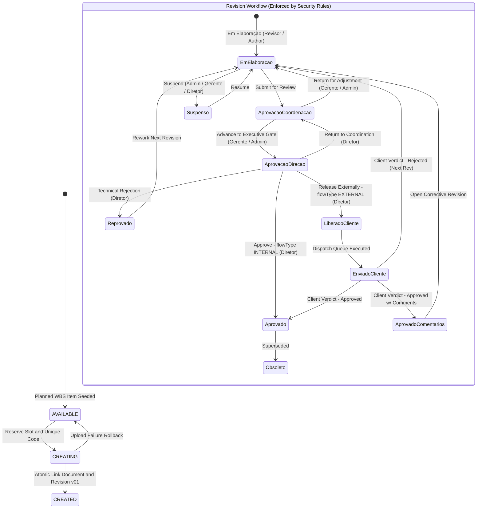
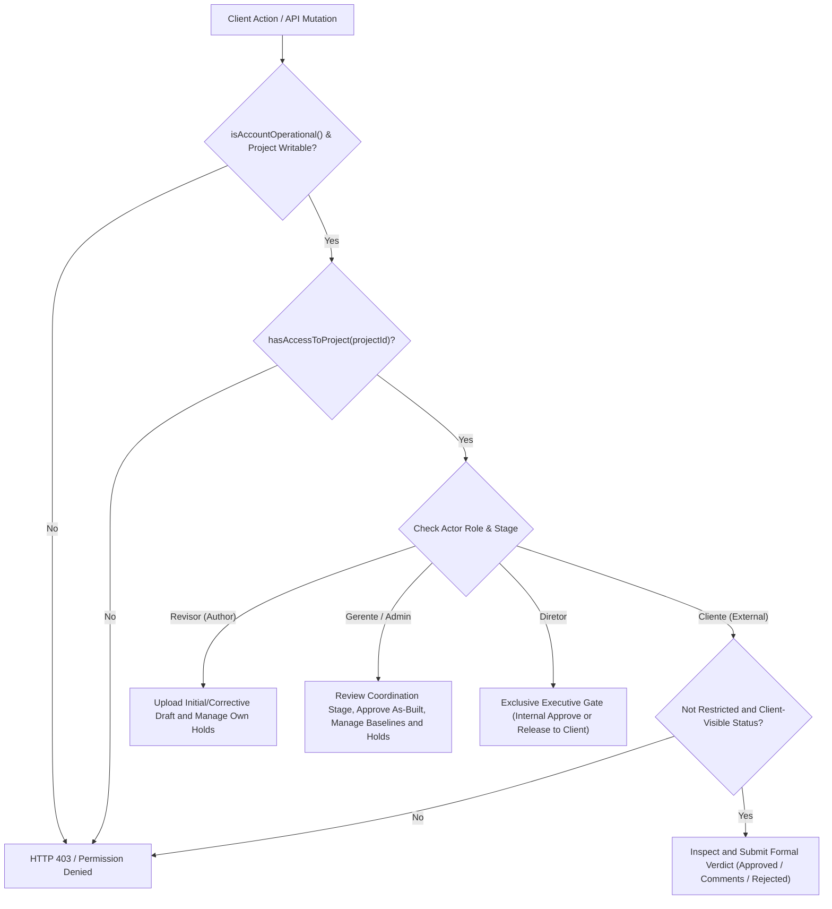
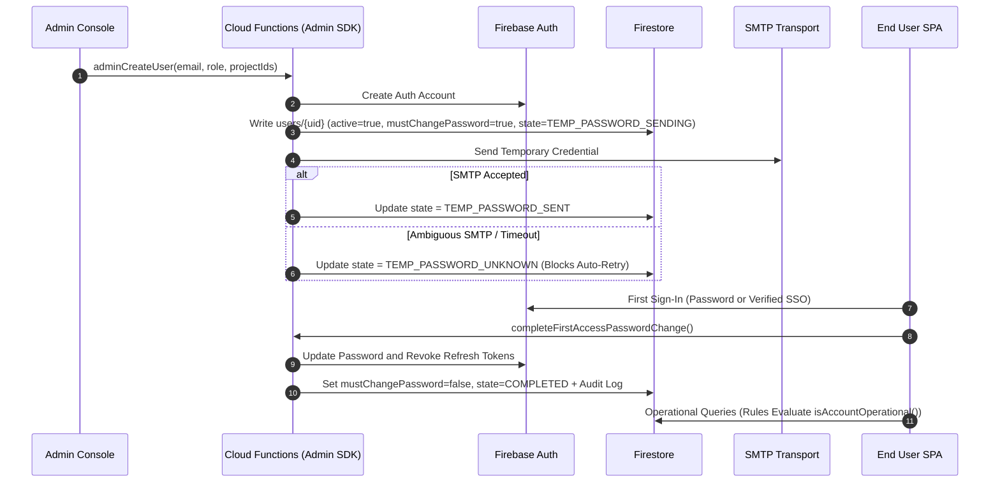
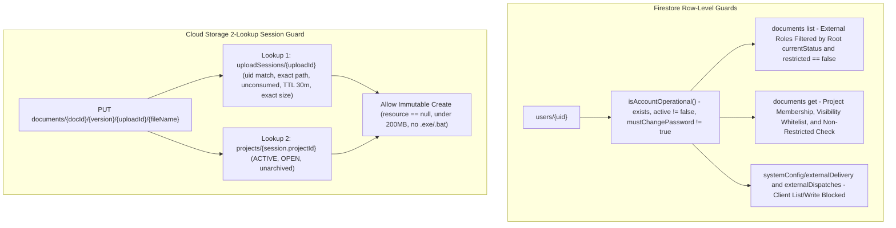
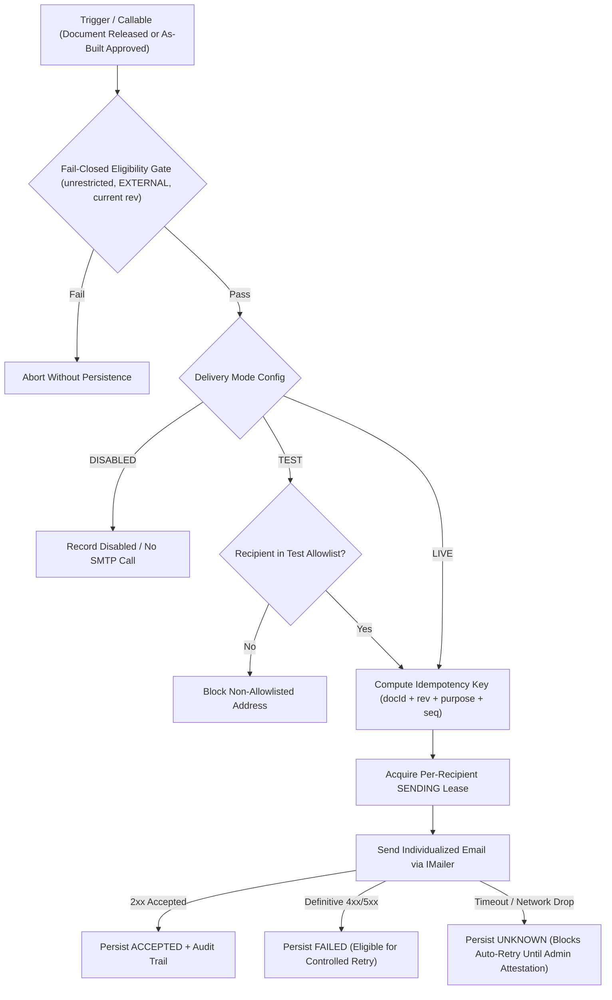
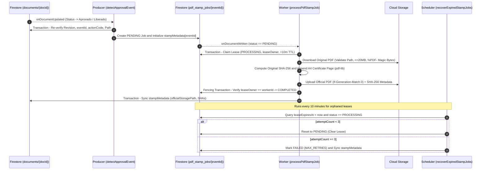
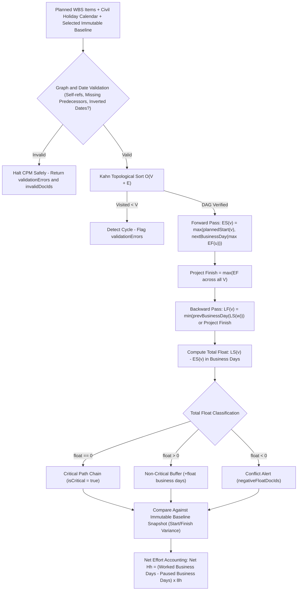
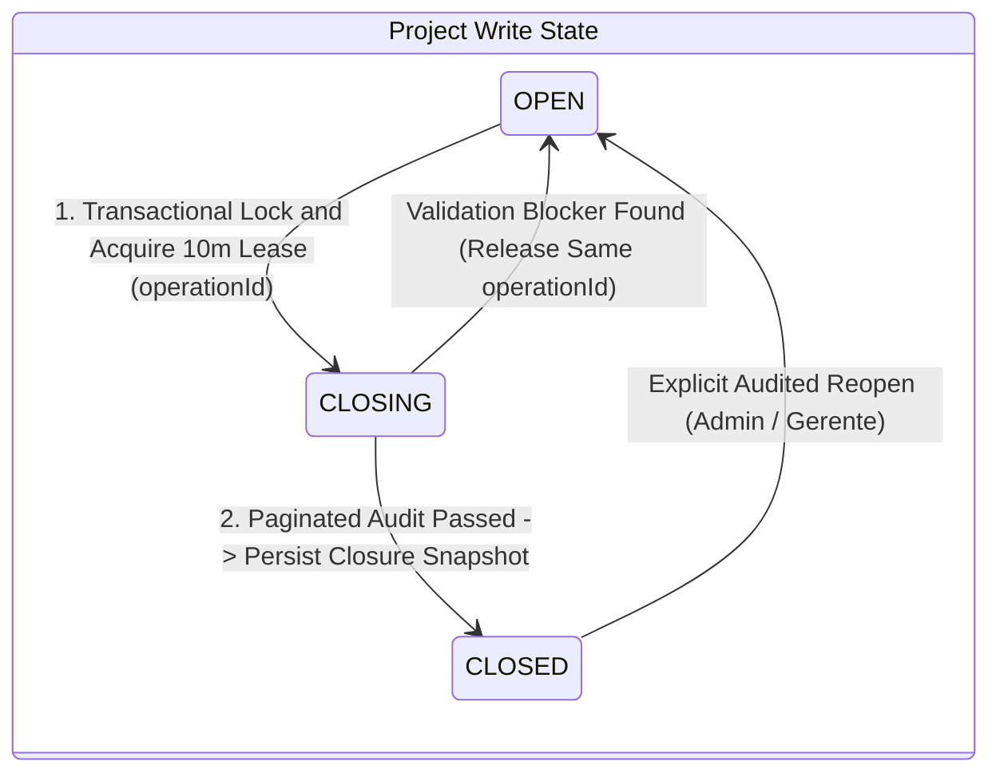
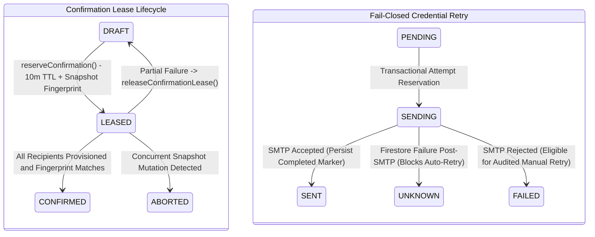

# PlanDoc — System Architecture & Engineering Flows

This document details the core architectural blueprints of **PlanDoc**, emphasizing authorization boundaries, asynchronous consistency, event-driven document certification, and deterministic schedule calculation.

---

## 1. End-to-End Document Lifecycle & 5-Role RBAC Approval Chain

Deliverables originate strictly from a pre-validated Work Breakdown Structure (*Planned Document List*). Creation reserves the unique document code transactionally (`AVAILABLE -> CREATING -> CREATED`) with automatic rollback on binary upload failure.

Once created, revisions follow a server-enforced finite state machine supporting two distinct paths:
- **`INTERNAL` Flow:** Terminates at `Aprovado` after Director deliberation (or authorized Manager bypass).
- **`EXTERNAL` Flow:** Advances through Director deliberation (`Liberado para o Cliente`) before triggering formal Client dispatch (`Enviado para cliente`) and external verdict (`Aprovado`, `Aprovado com Comentários`, or `Rejeitado` spawning `v02`).
- **`AS_BUILT` Coordination Flow (v2):** Field confirmation without technical edits links to the approved numeric revision; modified *As Built* deliverables require Coordination (`Gerente`) approval followed by non-deliberative informational dispatch.

### Role & Permission Gate Flow

---

## 2. Fail-Closed Onboarding & Row-Level Firestore / Storage Isolation

User privileges are never trusted from client claims or browser state. Accounts start pre-authorized and locked behind an onboarding state machine (`TEMP_PASSWORD_SENDING -> TEMP_PASSWORD_SENT -> COMPLETED`, or `TEMP_PASSWORD_UNKNOWN` on ambiguous SMTP responses requiring manual reconciliation).

### Multi-Service Isolation & Session-Bound Storage

Because Cloud Storage Security Rules impose a strict limit of **two cross-service `firestore.get()` / `exists()` calls** per rule evaluation, new uploads decouple authorization into pre-issued `uploadSessions/{uploadId}` documents:

---

## 3. Queue-Based External Delivery & PDF Trailer-Page Stamping

### A. External Delivery Outbox & SMTP Reconciliation

External notifications are separated from client approval state mutations and guarded against duplicate delivery, unauthorized test leaks, and silent network ambiguity:

### B. Event-Driven PDF Approval Certificate Stamping

When a technical document receives executive approval (`DIRECAO_APPROVE` or `APPROVE_WITHOUT_DIRECTOR`), an asynchronous pipeline produces an immutable certified copy with an appended A4 audit trailer page while preserving the original file intact:

---

## 4. Schedule Baseline + Critical Path Method (CPM) $O(V + E)$ Flow

Schedule analytics execute as pure memoized computations over the WBS graph without writing derived projections back to the database. All date arithmetic parses `YYYY-MM-DD` strings into civil calendar integers to prevent daylight-saving or UTC shifts.

---

## 5. Two-Phase Project Lifecycle Closure Gate

Project termination (`ACTIVE -> COMPLETED` or `CANCELLED`) decouples operational writability (`writeState: OPEN | CLOSING | CLOSED`) from catalog visibility (`archivedAt`) using a two-phase lock and lease protocol:

While in `CLOSING`, Firestore Rules, Storage session guards, and Admin SDK guarded writes reject new document mutations until either every deliverable/dispatch invariant passes (transitioning to `CLOSED` with an immutable `projectClosureSnapshots/{operationId}`) or an explicit blocker restores `OPEN`.

---

## 6. Transactional External Confirmation Lease & Fail-Closed Outbox

Confirming external recipient configurations or per-document overrides acquires a time-bounded snapshot lease before provisioning temporary credentials or triggering outbound notifications:

Separating `UNKNOWN` from `FAILED` guarantees that transient database outages after SMTP acceptance never trigger silent duplicate temporary-password dispatches on retry.