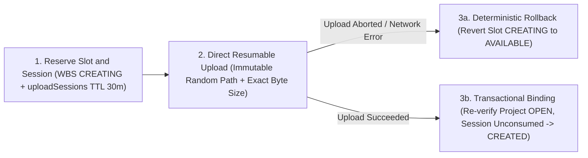

# PlanDoc — Quality Engineering & Security Controls

This document summarizes the engineering quality model, fail-closed CI emulator architecture, hosting security headers, and concurrency safeguards built into **PlanDoc**.

---

## 1. ISO/IEC 25010 Software Quality Alignment

PlanDoc's engineering standards map directly across the eight **ISO/IEC 25010 (SQuaRE)** product quality characteristics:

| Quality Characteristic | Architectural Implementation |
| :--- | :--- |
| **1. Functional Suitability** | End-to-end coverage of WBS planning, controlled revisioning (`v01`, `v02`, `AB`), 4-stage RBAC approvals, Finish-to-Start dependency locks (`dataFimReal`), and Brazilian civil-day SLA calendars. |
| **2. Performance Efficiency** | React 19 + Vite 6 SPA with project-scoped real-time listeners (`onSnapshot`), memoized $O(V + E)$ schedule/CPM passes, and SVG Gantt rendering tested for 1,000+ planned deliverables per project. |
| **3. Compatibility** | Coexists independently with external ERP/document workflows; supports delimiter-auto-detected CSV WBS imports and **UTF-8 with BOM** semicolon-delimited CSV exports for regional spreadsheet parsers. |
| **4. Usability** | Guided code-locked document creation from WBS items, cycle-prevention validation (`validatePredecessors`), contextual *Google-style* threaded comments (`Ctrl + Enter`), and integrated operational help manuals. |
| **5. Reliability** | Atomic Firestore transactions (`runTransaction`) for uniqueness locks (`unique_documents`, `unique_planned_documents`), automatic slot rollback on failed uploads, append-only revision history, and immutable baselines. |
| **6. Information Security** | Multi-tenant project scoping, fail-closed `isAccountOperational()` enforcement, server-side status FSM, immutable `auditLogs`, session-bound uploads, and restricted-document isolation. |
| **7. Maintainability** | Strict TypeScript (`strict: true`), clear separation between pure deterministic domain engines (schedule math, taxonomy normalization, revision parsing, lifecycle policies) and Firebase I/O adapters, backed by automated unit & emulator suites. |
| **8. Portability** | Browser-agnostic SPA hosted on CDN-backed Firebase Hosting alongside JSON-document Firestore schemas compatible with Cloud Storage / BigQuery analytics exports. |

---

## 2. Fail-Closed CI Harness & Firebase Emulator Isolation

Integration and Security Rules verification runs against real local **Firebase Emulators** (`Auth`, `Firestore`, `Storage`, `Functions`) orchestrated by a fail-closed test runner designed to make accidental contact with production cloud resources structurally impossible.

### Key CI & Runner Safeguards

1. **Strict `demo-*` Project Prefix Enforcement:**  
   Every emulator execution validates `GCLOUD_PROJECT`, `GOOGLE_CLOUD_PROJECT`, and `GCP_PROJECT` against `/^demo-[a-z0-9-]+$/`. Non-demo project IDs abort immediately before spawning tests.
2. **Loopback-Only Binding Verification:**  
   `FIRESTORE_EMULATOR_HOST`, `FIREBASE_AUTH_EMULATOR_HOST`, `FIREBASE_STORAGE_EMULATOR_HOST`, `FUNCTIONS_EMULATOR_HOST`, and `STORAGE_EMULATOR_HOST` must match `127.0.0.1:<port>` or `localhost:<port>`.
3. **Credential & Secret Stripping:**  
   The test orchestrator strips ambient `SMTP_*` keys, `GOOGLE_APPLICATION_CREDENTIALS`, `CLOUDSDK_AUTH_CREDENTIAL_FILE_OVERRIDE`, and `FIREBASE_CONFIG` from child environments, and fails immediately if any `.env*` or `.secret*` file is detected in `functions/`.
4. **Hermetic Mailer Guard:**  
   `FakeMailer` refuses to instantiate unless `NODE_ENV === 'test'` and `FUNCTIONS_EMULATOR === 'true'`, eliminating any possibility of real external emails leaving CI or developer machines during tests.
5. **Runtime Parity & Per-Suite Isolation:**  
   Enforces **Node 22** (matching the Cloud Functions runtime engine), compiles `functions/tsconfig.json` before starting `firebase emulators:exec`, and invokes integration suites sequentially with isolated demo project namespaces where required so `@firebase/rules-unit-testing` fixtures never collide.

### Verification Tiers

- **Pure Unit Suites (`test:unit`):** Deterministic tests covering civil calendars, net Hh accounting, baseline variances, Priority Shift cascades, taxonomy resolution, revision numbering, upload feature gates, and lifecycle closure policies.
- **Emulator Integration & Rules Suites (`test:integration`):** Real rule-evaluation and Cloud Function callable tests verifying:
  - Firestore `users`, `projects`, `documents`, `plannedDocuments`, `projectBaselines`, `auditLogs`, and `externalDispatches` RBAC boundaries;
  - Storage session-bound uploads, byte-size enforcement, and cross-service visibility checks;
  - Transactional external delivery, informational *As Built* outbox isolation, PDF stamping leases/retries, and two-phase project closure locks.

---

## 3. HTTP Security Headers & Hosting Hardening

Production static assets served through Firebase Hosting enforce hardened browser transport and framing policies:

| Header | Policy Value | Security Objective |
| :--- | :--- | :--- |
| `Strict-Transport-Security` | `max-age=63072000; includeSubDomains; preload` | Enforces HTTPS HSTS across subdomains for 2 years |
| `X-Content-Type-Options` | `nosniff` | Prevents MIME-type sniffing attacks |
| `X-Frame-Options` | `DENY` | Eliminates clickjacking via iframe embedding |
| `Referrer-Policy` | `strict-origin-when-cross-origin` | Prevents leaking sensitive internal URL paths cross-origin |
| `Permissions-Policy` | `camera=(), microphone=(), geolocation=(), interest-cohort=()` | Disables unused hardware APIs and FLoC/interest cohorts |
| `Cache-Control` (HTML) | `no-cache, no-store, must-revalidate` | Prevents stale security/UI shell caching across releases |
| `Cache-Control` (Assets) | `public, max-age=31536000, immutable` | Safe immutable caching for content-hashed JS/CSS/font bundles |

---

## 4. Defensive Upload Reservation & Concurrency Controls

Because Cloud Storage object writes and Cloud Firestore document updates cannot span a single distributed ACID transaction, PlanDoc guards binary ingestion using a **reserve-upload-bind-rollback** protocol:

### Invariants Protected

1. **No Orphaned WBS Locks:** Failed or interrupted uploads revert `plannedDocuments.status` back to `AVAILABLE` (and allow initial `v01` draft cleanup only for the original `authorId` in `Em Elaboração` / `Para Revisão`).
2. **No Silent File Swaps:** Once a revision reaches `Aprovado` or `Aprovado com Comentários`, Firestore Rules lock `revisions` and `fileUrl` when status remains unchanged, and Storage Rules block `update`/`delete` on existing object paths (`allow update, delete: if false`).
3. **Upload Session Consumption:** Server-issued upload sessions bind `uid`, `projectId`, `documentId`, `expectedRevisionVersion`, `fileName`, and `sizeBytes`. If a revision advances mid-upload, the binding transaction rejects stale linkage and leaves historical artifacts untouched.
4. **Two-Phase Closure Protection:** All project-mutating callables and guarded writers inspect `writeState` inside their commit transaction (`read-before-write`), ensuring concurrent operations cannot slip past a `CLOSING` or `CLOSED` project boundary.
